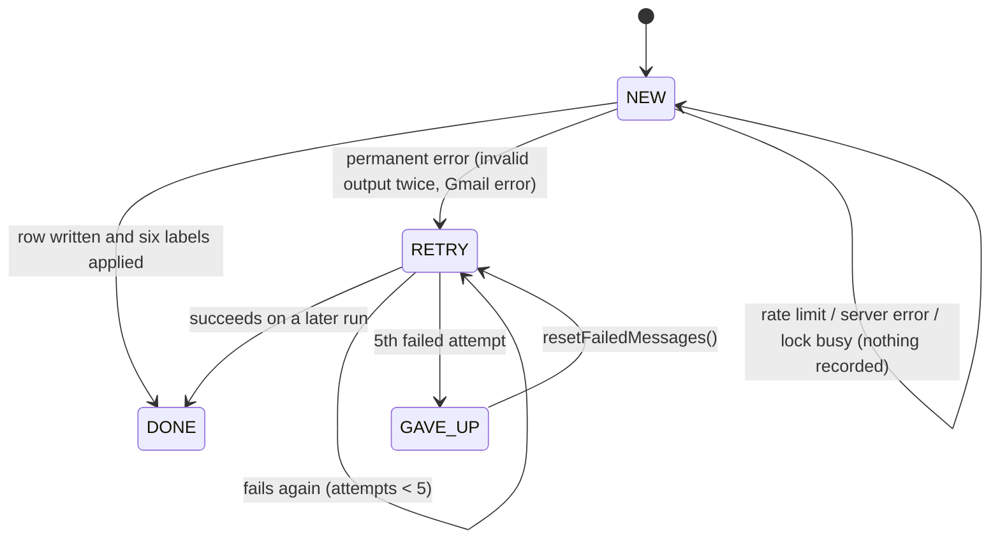
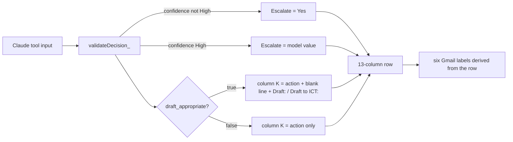

# Flow definitions

Three views of the same flow. The machine-readable version is [`triage-flow.json`](triage-flow.json);
`npm run check:flows` verifies that every function and limit named there exists in `src/Code.gs`.

## 1. One run (every 5 minutes, or `runDemo` by hand)

```mermaid
sequenceDiagram
    autonumber
    participant T as Trigger / you
    participant S as Apps Script (Code.gs)
    participant G as Gmail
    participant C as Claude API
    participant W as Google Sheet

    T->>S: processNewEmails() / runDemo()
    S->>S: take script lock (skip run if another run holds it)
    S->>W: ensure "Triage Results" (13 columns) and "_triage_state"
    S->>G: list inbox messages after setup time, oldest first (max 10 handled per run)
    loop each message not DONE / GAVE_UP
        alt a result row already exists for this message ID
            S->>G: re-apply the six labels from the row (no new row, no Claude call)
        else new message
            S->>G: read sender, subject, received time, plain-text body
            opt allowlist set and sender not on it
                S-->>S: skip (no state recorded)
            end
            S->>C: system prompt + record_triage tool + email JSON in <untrusted_email>
            C-->>S: tool_use input (structured decision)
            S->>S: validate; apply escalation rule; build column K
            S->>W: write ONE row for this message ID (plain text)
            S->>G: add six Triage/... labels to this message
        end
        S->>W: state = DONE
    end
```

## 2. State of one message



A message whose row was written but whose labelling failed stays `RETRY`; the next run finds the row and only
re-applies the labels, so no duplicate row is ever written.

## 3. What happens when something goes wrong

| Situation | Kind | Effect |
|---|---|---|
| HTTP 429, 5xx, 529, network error | transient | short backoff inside the call; if it persists the batch stops; nothing is marked processed; attempts are not consumed |
| HTTP 400, 401, 403, 404 from Claude, or missing Script Properties | fatal | the run stops and raises an error (shown in Executions); attempts are not consumed |
| Invalid, cut-off or missing tool output (after one extra try) | permanent | no row written; attempts + 1; `RETRY`, then `GAVE_UP` at 5 |
| Gmail read or label failure for one message | permanent | attempts + 1; if the row exists, the next run recovers only the labels |
| Another run holds the lock | skip | this run does nothing |

## 4. Output contract


